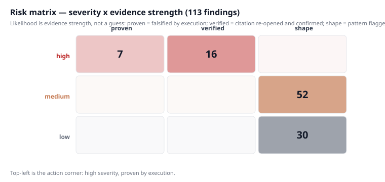

# Code review — loop-console dashboard

**Target** `dashboard/` · **Mode** `full` (5 phases) · **Date** 2026-08-11
**Findings** 113 — 23 high · 52 medium · 30 low · 8 info  ·  **0 critical**

## Read this first

This is a **mature, unusually well-disciplined codebase**, and the shape of its defects follows from that.

Measured, not asserted: `knip` reports **zero** unused files and **zero** unused runtime exports across the whole
project graph. `lizard` over 185 production `.ts` files reports 1425 functions with **1289 at CCN ≤ 5** and only two
above CCN 25. A grep census over all 416 production files finds **zero** empty `catch` blocks, **zero** `any`
annotations and **zero** `@ts-ignore`. `eslint` plus a custom guard-pair script pass clean. The test suite has 2947
tests, 5980 assertions, **zero** `.only`, and **zero** tests without an assertion.

So the finding list is not a list of sloppy code. **Nineteen of the 23 high-severity findings are the same defect**
**shape**, and naming it is the single most useful output of this review:

> A rule is decided, written down, and correctly applied somewhere in the repository — and a second copy diverges,
> with no mechanical guard able to notice.

The team's instinct is already right. `device-verify.tsx:70` states the doctrine in as many words: *"um guard de
segurança não chamado é pior que ausente: dá a impressão de que a proteção existe"*. That sentence describes four
of the findings below, written by the same people who wrote the finding.

## The four families

| # | Family | Instances | Worst case |
|---|---|---|---|
| **F1** | A security guard exists, is tested, and is not called | 5 call sites | The user's **plaintext password** is POSTed to a URL chosen by a network response (`login.tsx:230`) |
| **F2** | A transport swap changed a callback's meaning; the policy did not follow | 1 hook, 2 findings | A finished deploy left open in a tab reconnects and re-exchanges a token every ~500–1000 ms, forever (`use-sse-stream.ts:192`/`:234`) |
| **F3** | A readiness gate that is not settled-success | 4 capability screens | A **compliance** screen states "No violation recorded" when nothing was read (`trust/overview.tsx:204`) |
| **F4** | A test that asserts absence of something absent in both worlds | 96 files, 4 proven | Deleting a guard entirely leaves **10/10 tests green** (`skills/overview.test.tsx:184`) |

**The suite is fully green: 2888 of 2888 tests pass across 965 suites.** That is the point, not a reassurance —
the four assertions proven unable to fail are green too, and were green while the code they guard was deleted.
A green suite carries less information here than it appears to.

F4 is why F1–F3 survived. The guards the team built are real and load-bearing — `residence-rule`, `parent-barrel-import`,
`modal-primitive`, `kpi-primitive-unification`, `data-access-layer`, `query-key-convergence`, `i18n-guard` were each
checked and each **holds**. The gap is that they guard the layers where the team already got burned, and the four
families above sit in the layers that were never guarded.

## The seven proven-by-execution findings

These were not reasoned about. Someone changed the code and ran the suite.

| Finding | What was executed | Result |
|---|---|---|
| #110 | Deleted the chart guard from `skills/overview.tsx` entirely | **10/10 tests still passed** |
| #110 | Restored the zero-sliver floor the CHANGELOG says was fixed | **18/18 tests still passed** |
| #110 | Ran `rendered()` regex against a JSX tag inside a comment | **matched** — the hole its docblock claims it closed |
| #84 | `promptsPorAmbiente([{labels:[{label:'prod'}]},{labels:[{version:1}]}])` | **TypeError** — the whole page unmounts |
| #83 | Evaluated both projections on the file's own fixture | **2 vs 1** under the same on-screen label |
| #85 | Rendered `value: NaN` | `width: 0%` beside a cell reading **NaN** |
| #88 | Traced `coverageGap(validators=undefined)` | every bar painted amber "unblocked" |

## Remediation — ordered by families, not by tickets

Fixing 23 tickets one by one leaves the shape intact and the next divergence unguarded. Fixing four families with a
guard each closes them and prevents recurrence.

| Order | Action | Closes | Effort |
|---|---|---|---|
| 1 | Call `isSafeRedirectUrl` at the five unguarded call sites; add a guard test asserting every `form.action =` and `location.href =` assignment from a network value is gated | F1 (#40, +4) | **S** — the guard exists; this is 5 lines + 1 test |
| 2 | Make the SSE error policy distinguish clean stream end from failure; scope `clearToken()` to the SSE credential | F2 (#62, #63) | **M** — needs a decision about `falhar()` semantics |
| 3 | Replace `!error && !loading` with `isSuccess && data != null` on the four screens; add a guard test over the gate expression | F3 (#86, #87, #88, +1) | **S** — three of five adopters already do it right; copy them |
| 4 | Change absence assertions to target an element present in the passing case; extend `capability-overview.test.ts` to strip comments and string literals before matching | F4 (#110) | **M** — 4 files to fix, 92 to audit |
| 5 | Reconcile the two CSPs to one generated source; add a directive-by-directive test that the header is never narrower than the meta | #3 (and removes F1's dependence on CSP) | **S** |
| 6 | Decide the pt/en convention explicitly, then sweep | 8 naming findings | **M** — see below |

### On the Portuguese/English split — a decision, not a cleanup

An AST pass over 775 files (TypeScript compiler, declaration nodes only) binned by git creation date:

| Period | Files | With pt identifiers |
|---|---|---|
| 2026-04 → 07 | 550 | 4.5% |
| **2026-08** | **225** | **71.1%** |

That is a **16× step change in one month**, not gradual drift — a convention shift someone made, not a mistake that
crept in. Two facts should shape the response. Portuguese **comments** are long-standing while Portuguese
**identifiers** are new to August, so the two are separable decisions. And `src/test/i18n-guard.ts` already proves
with a three-legged AST guard that **zero** Portuguese reaches the user interface — the product surface is clean and
machine-enforced. What is left is an internal contradiction with the project's stated English-everywhere rule, and
it needs a decision before it needs a sweep.

## What was NOT reviewed

Stated plainly, because the alternative is letting silence imply coverage.

- **Deep inspection reached 115 of 830 files (13.9%).** A further 676 (81.4%) were covered only by
  dimension-specific mechanical sweeps (complexity metrics, anti-pattern census, AST language classification,
  structural shape classification). **These two numbers are not summed anywhere in this report.** Summing them would
  produce a 96% figure asserting a review that did not happen — the exact defect class this report documents.
- **Line and branch coverage were never measured.** The suite itself was run to completion (see below), but without
  the `--coverage` flag, so no line or branch percentage exists. Any such number in this report would be invented.
- **Order dependence was never tested.** 37 test files hold mutable module-level state, which is the precondition
  for it. Proving it needs `vitest --sequence.shuffle`, which was not run.
- **90 of the 96 weak-assertion test files were not individually falsified.** Four were proven; the rest are flagged
  as a shape to audit. Calling all 96 defects would inflate 4 facts into 96.
- **`DESIGN.md` §§ 1, 4–6, 10–20** (5Q-3s, empty-state and error-state structures, the 18-point per-screen DoD) are
  qualitative acceptance gates over ~123 screens. Verifying them is a per-screen manual review, not a doc↔source
  cross-check. Neither confirmed nor denied.
- **Runtime behaviour was never exercised.** This is a static review. No browser, no deployed environment.

## A defect in this audit

Two of them, both published rather than quietly fixed.

**The inventory dropped `src/build/` entirely.** The phase-1 exclusion list held the bare name `build`, meant for
build artefacts, and it matched `src/build/` — 8 source files of build *policy* (chunk splitting, service-worker
caching, CSP) that ship as tested code. No phase could route an agent there, and every coverage denominator before
the correction was wrong. Found by an agent that enumerated the filesystem instead of trusting the inventory table.
A name-based exclusion is the same defect shape as a name-based pattern match — both fail silently. Filed as #113.

**Coverage was being inflated by the review's own agents.** Two agents marked files `inspected` at 6–7 files per
second, a rate that proves they were swept, not read. Left alone the run would have reported **96.1%** coverage. The
root cause was this reviewer's own instruction telling them to mark what they swept. The correction rule — a file
counts as inspected only if the agent **named** it in its own report — was declared *before* the resulting numbers
were computed, so the threshold could not be chosen to clear the gate. It does not clear the gate: phase 3 wanted
40% and phase 4 wanted 60%; deep inspection ended at 13.9%.

## Coverage and evidence

| Metric | Value |
|---|---|
| Files inventoried | 835 |
| Deep-inspected | 115 (13.9%) |
| Swept (mechanical, dimension-specific) | 676 (81.4%) |
| Test files audited | 376 / 376 (100%) |
| Tests / assertions (static count) | 2947 / 5980 |
| Suite run (measured) | **2888 / 2888 passed, 0 failed**, 965 suites |
| Tool runs recorded | 4 (knip, lizard, grep census, vitest) |
| Findings with structured `file`+`line` | 113 / 113 |
| Citations independently re-verified | 22 (100% of high-severity) |
| Fabricated citations found | 0 |

## All high-severity findings

| # | Category | Location | Finding |
|---|---|---|---|
| 1 | completeness | `src/pages/auth/recovery.tsx:21` | recovery.tsx ignores the ACCOUNTS_URL runtime config the sibling auth module honors |
| 3 | completeness | `nginx-security-headers.conf:31` | The shipped response-header CSP is strictly narrower than the meta CSP, silently revoking six allowances index.html documents as required |
| 5 | completeness | `src/routes/settings-routes.tsx:51` | Placeholder screens advertise loopscale CLI commands that do not exist (settings domain) |
| 8 | completeness | `src/routes/profile-routes.tsx:32` | Placeholder screens advertise loopscale CLI commands that do not exist (profile domain) |
| 9 | completeness | `src/pages/overview/overview.tsx:154` | Overview project cards display a hardcoded deploy branch of main for every project |
| 12 | completeness | `src/components/layout/team-switcher.tsx:126` | Create team menu item does not create a team — it opens a docs page in a new tab |
| 13 | completeness | `src/pages/settings/billing.tsx:380` | Billing upgrade CTAs hardcode prices and quotas that the API already exposes |
| 39 | code | `src/pages/infra/domains.tsx:189` | The loading/error/empty/data ladder is a copy-pasted convention, not a primitive: 6 pages omit the error leg and render an empty state on failure (#274 class, alive; silent-null-guard cannot see it) |
| 40 | security | `src/pages/auth/login.tsx:230` | Credentials POSTed to an unvalidated server-supplied URL (flow.ui.action) |
| 41 | error_handling | `src/lib/auth/session.ts:163` | Logout silently proceeds to /login when the Kratos logout call fails — server session survives |
| 42 | error_handling | `src/hooks/use-auth.ts:17` | getSession() null collapses transient token-exchange failures into a forced /login redirect |
| 43 | error_handling | `src/pages/auth/login.tsx:136` | Login page swallows both flow-hydration failures — Sign in button becomes a no-op with zero feedback |
| 44 | contract | `src/lib/http/api.ts:303` | cloudFetch fabricates ApiError(429) for failures that were not rate limits — and retryGuard then refuses to retry |
| 62 | concurrency | `src/hooks/deploy/use-sse-stream.ts:192` | Exponential backoff defeated by reopenAttempts reset on onopen — open/close cycle reconnects every ~750ms forever |
| 63 | error_handling | `src/hooks/deploy/use-sse-stream.ts:234` | Every SSE error clears the application-wide access token, not just the SSE credential |
| 65 | error_handling | `src/hooks/mutations/use-cancel-build.ts:9` | useCancelBuild reports success when the cancel request fails — engineFetch resolves null instead of throwing |
| 83 | code | `src/pages/promptly/components/projections.ts:77` | Chart bar and KPI card share the label 'not promoted' for two different quantities |
| 84 | error_handling | `src/pages/promptly/components/projections.ts:113` | localeCompare on an unvalidated label entry unmounts the whole /promptly overview |
| 85 | contract | `src/components/charts/category-bars.tsx:100` | barWidths sanitises the value but the number cell prints the raw one — a 0%-wide bar beside a cell reading NaN |
| 86 | contract | `src/pages/skills/overview.tsx:263` | The chart gate !error && !loading is not settled-success, so the chart asserts 'Nothing recorded' beside a fully populated table |
| 87 | contract | `src/pages/trust/overview.tsx:204` | Same paused/idle blind spot on the one screen where an empty distribution is a compliance claim |
| 88 | contract | `src/pages/trust/overview.tsx:213` | When only the validators query fails, every bar is painted amber 'unblocked' — asserting nothing is stopped precisely when the code knows it cannot tell |
| 110 | code | `src/pages/skills/overview.test.tsx:184` | 96 test files assert absence with queryBy alone — a shape already PROVEN unable to fail on four of them |

Full detail with verbatim evidence and remediation for every finding:
`findings/completeness/phase2-completeness.md`, `findings/code/phase3-code-review.md`, and the `findings` table in
`code-review.db`.

